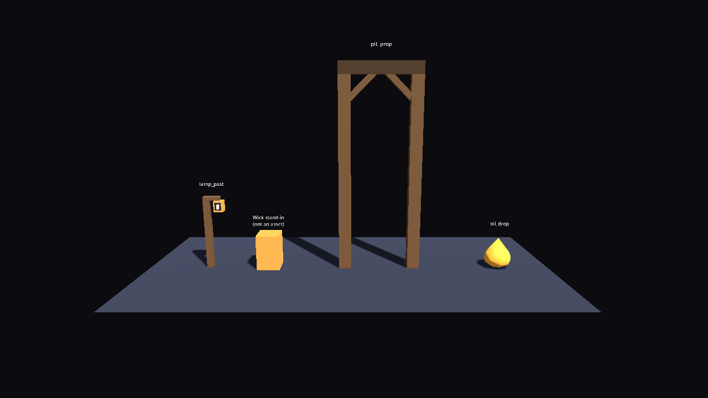
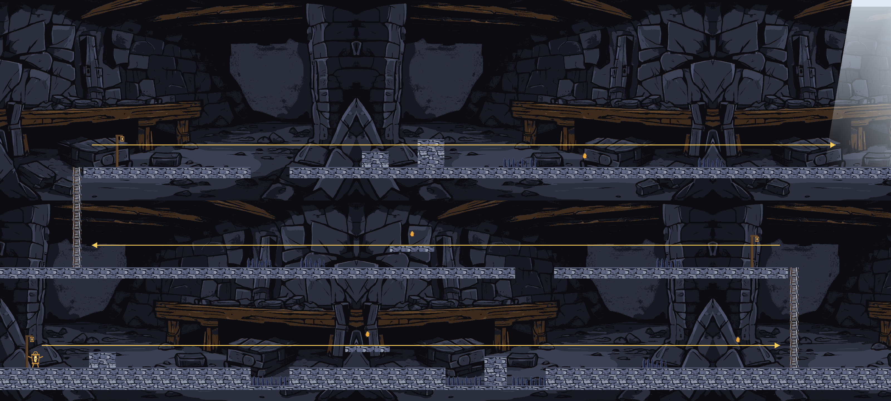

# walker-lamplight-rui-sun

**Lamplight** — Rui Sun's cumulative game for CSYE 7270 Fall 2026. Each assignment adds one layer to
this repository and is submitted as a git tag (A3: `a3`).

- **Assignment 3 — "Your First 3D Game Assets with Claude, the Blender MCP, and Blender"** (this layer,
  section below)
- **Assignment 2 — "Generate Art, Sound, and Music for Your Game"**: the 2D asset slice, submitted at
  `4cef687` (further below)

## Assignment 3 — three 3D assets for Lamplight

Lamplight is a **2D** side-view pixel platformer. A3 adds three simple 3D assets from the game and a
small Godot 3D scene, the **asset room**, that shows them side by side at game scale. The room is not
connected to the 2D game yet; Assignments 4 and 5 reuse it.



| Asset | Role in Lamplight | Size W × D × H (m) | Triangles |
|---|---|---|---|
| `lamp_post` | the checkpoint lamp post | 0.19375 × 0.0955 × 0.725 (origin at the post's foot) | 60 |
| `oil_drop` | the oil pickup | 0.275 × 0.275 × 0.30 | 64 |
| `pit_prop` | a mine-tunnel timber support (set dressing) | 0.8 × 0.12 × 2.0 | 60 |

Scale: **160 px = 1 m** (Wick 0.35 m, tunnel 2.0 m). The oil drop is deliberately 2× that conversion after
Rui's human check (brief §9).

### Versions

| Tool | Version |
|---|---|
| Godot | 4.7.2.stable.official.ed1daf0bf (GL Compatibility) |
| Blender | 5.1.2 (glTF exporter io_scene_gltf2 5.1.20) |
| MCP for Blender | `mcp-for-blender` 2.1.9 (add-on 1.8) — the **MCP route** was used for all three assets |
| OS | Windows 11 |

### Open the scene

```bash
godot --path godot res://game3d/asset_room.tscn
```

Right-drag orbit, wheel zoom, middle-drag pan. Keys: **0** overview, **1** lamp post, **2** pit prop,
**3** oil drop, **4** Wick stand-in. The floor is single-sided, so you can look at every asset from below.

### Run the checks

These commands are written for Windows with Git Bash. `godot` / `blender` stand for the console
executables, for example `Godot_v4.7.2-stable_win64_console.exe`.

```bash
godot --headless --path godot --import
timeout 120 godot --headless --path godot --script res://tests/check_a3_assets.gd --fixed-fps 60
python tools/check_glb.py
bash tools/run_tests.sh
```

- `check_a3_assets.gd` loads each imported `.glb` and the asset room. It prints the bounding-box size, the
  lowest Y, the X range, every node's scale and rotation, the tallest axis, the triangle count and the
  albedo colours, and compares them with the brief (±1 mm). It also checks each asset against the
  **Floor** node's height and that the room has one light and one camera. 30 checks.
- `check_glb.py` reads each `.glb`'s own glTF JSON with no Blender and no Godot. 18 checks.
- `run_tests.sh` runs A2's suites plus `check_a3_assets`.
- Each check was shown to fail on a deliberate fault (TEST-REPORT §6).

Rebuild the `.glb` files from the `.blend` sources:

```bash
for a in lamp_post oil_drop pit_prop; do blender -b blender/$a.blend --factory-startup --python-exit-code 1 --python tools/blender/export_glb.py -- godot/assets/models/$a.glb; done
```

### What Assignment 3 added

- `blender/*.blend`: the three Blender sources.
- `tools/blender/build_*.py`: every `execute_blender_code` body Claude ran through the MCP, in order,
  with the observed results. They replay headless (TEST-REPORT).
- `tools/blender/export_glb.py`: the exporter.
- `tools/check_glb.py`: the independent file check.
- `godot/assets/models/*.glb` (+ `.import`): the exported assets.
- `godot/game3d/asset_room.tscn`, `orbit_camera.gd`: the asset room.
- `godot/tests/check_a3_assets.gd`: the headless check. `capture_a3_room.gd`: scripted screenshots.
- `docs/a3/`: [CHANGE-BRIEF](docs/a3/CHANGE-BRIEF.md) (committed before any asset, tag `a3-brief`) ·
  [BLENDER-NOTES](docs/a3/BLENDER-NOTES.md) (Rui's words and screenshot) ·
  [TEST-REPORT](docs/a3/TEST-REPORT.md) · [FRICTIONAL](docs/a3/FRICTIONAL.md) ·
  [SOURCES](docs/a3/SOURCES.md) · `evidence/`.

### Known limitations (A3)

- **The numbers do not prove the look.** Under the room's light the colours render lighter and more
  saturated than their hex values (the oil drop reads lemon-yellow). Rui accepted the revised room but did
  not comment on colour specifically.
- The room uses one neutral directional light plus ambient, **not** the game's dark scene with one warm
  point light. How the assets look in Lamplight's real lighting is untested.
- The **Wick stand-in is a box**, not a 3D Wick. It gives the height, but it looks bulkier than the real
  lantern character, which may have made the original oil drop look smaller than it is.
- The oil drop no longer follows the 160 px = 1 m conversion (×2 on purpose). The pit prop does not exist
  in the 2D game yet.
- `lamp_post`'s build script replays the shapes but not Rui's hand edit (the flame colour). The `.blend`
  file is the source of truth for that asset.
- The checks compare against the brief's numbers. They cannot tell whether the brief's numbers were the
  right ones. That is what the human check is for.

### Assignment 3 film

*To be added.* The Brutalist explainer film is not made yet. Its link, filename and SHA-256 will go here.

## Assignment 2 — the asset slice (submitted at `4cef687`)

You are **Wick**, a small walking lantern spirit lost in an abandoned mine. Your flame is your life and
your only light: oil drains every second, oil drops refill it, and at zero your ember lasts four seconds.
Climb out through three tunnels to the daylight.



This repository is an **asset slice**: one playable level that proves the generated art, sound effects
and music work together in Godot. It is not the whole game.

### Started from (A2)

The Godot project structure (`godot/`) was imported from
[nikbearbrown/walker-jumpman](https://github.com/nikbearbrown/walker-jumpman) at commit `9387542`
(player controller, session state machine, HUD, tests). Only the engine project was copied. Since then
the viewport, tuning, level, art, audio, lighting, HUD and tests have been rebuilt for Lamplight.
Credits and every model's license: [SOURCES.md](SOURCES.md).

### Engine

Godot **4.7.2.stable.official.ed1daf0bf**, GDScript, GL Compatibility renderer, 1280×720 viewport.
Tested on Windows 11 with an RTX 3070 Laptop GPU.

### Run

Open `godot/project.godot` in the Godot 4.7.2 editor and press F5, or from the repository root:

```bash
godot --path godot
```

Tests (headless, all suites; fails on any failed check or script error):

```bash
bash tools/run_tests.sh
```

Asset checks (sprite proportions, colours, in-engine contrast, loop seam numbers; needs Python 3 + Pillow + NumPy):

```bash
python tools/check_assets.py
```

### Controls

| Key | Action |
|---|---|
| Enter | start / resume / play again |
| A / D or ← / → | move |
| Space | jump |
| W / S or ↑ / ↓ | climb a ladder (Down at a ladder's top grabs it) |
| R | back to the last lamp post |
| Esc / P | pause |
| M | main menu (from pause or the end card) |
| **N** | mute / unmute **music** |
| **B** | mute / unmute **effects** |

### What the slice demonstrates

- **Generated character, 9 states:** idle, walk, jump, fall, climb, oil pickup, ember, hurt, celebrate.
  All derive from one SDXL reference and swap as static images; Wick faces left by a runtime flip.
- **Generated environment:** back wall, rock tiles, spikes, oil drops and ladder (SDXL, pixelised to a
  fixed palette). The lamp posts, the exit daylight, the light and the HUD are drawn in code.
- **Four event sounds** (MusicGen): jump, oil pickup, hurt, exit. Each plays once per event and only
  listens to game signals; sound never decides anything.
- **A music loop** (MusicGen, 8 bars at 90 bpm). It gets muffled as the oil drops, dips on death, pauses
  in place and stops at the exit.
- **Readable muted:** every sound has a visual twin; the light ring and the gauge carry the oil.

Design documents: [CONCEPT](CONCEPT.md) · [STORYBOARD](STORYBOARD.md) (hand-drawn) ·
[CHARACTER-SHEET](CHARACTER-SHEET.md) · [CHANGE-BRIEF](CHANGE-BRIEF.md) · [TEST-REPORT](TEST-REPORT.md) ·
[FRICTIONAL](FRICTIONAL.md) · [SOURCES](SOURCES.md) (with the asset log).

### Known limitations

Full list: [TEST-REPORT.md §10](TEST-REPORT.md). In short:

- The oil-to-music muffling is subtle (Rui: "a little difference"); it is the main audio signal of
  "every second burns".
- The effects are cut from a music model's output, not designed one-shots.
- Chaining the jump between the middle tunnel's two spike strips at full speed needs near-frame-perfect
  timing; stopping in the gap works. Widening it is the first level change for the full game.
- Climb uses a front view with a faceless flame standing in for the back view (the model drew no back view);
  the fall image's eyes are off-centre; no animation (one static image per state).
- The mirrored repeat of the generated back wall is visible; the outdoor exit scene was not generated.
- The character-sheet drawings are SVG (Rui's choice); the storyboard is hand-drawn.
- The film's gameplay is scripted input through real `Input` actions, not human play.

### Assignment 2 film

**[▶ Watch the film](https://northeastern-my.sharepoint.com/:v:/g/personal/sun_r3_northeastern_edu/IQApLUVOtRgNSa8IJEat3WgqAatgl7QkgIaf07zQCJS8u24?e=Lqm1EB)** — Northeastern OneDrive, viewable by anyone signed in with a Northeastern account.

| Field | Value |
| --- | --- |
| Filename | `claude-liam-walker-lamplight-gamedev.mp4` |
| SHA-256 | `f0ae62846568d6013f68f96b63f891486d3302910da23aca04f36d2bd12c41d7` |
| Format | 3840×2160 H.264, 30 fps, AAC 48 kHz stereo |
| Duration | 329.93 s (5 min 30 s) · 64.7 MB |
| Game revision shown | `a70758da954068bafc3de1058f9eaebff318b16a` (capture `build_id` `718aeab3…7c71e`) |
| Workflow | Brutalist `godot-gamedev`, walker mode; narration Kokoro `am_onyx` ("Liam") |
| Hosting | Northeastern OneDrive; link scope "People in Northeastern University with the link", view-only |

The film's beat sheet, prompts, fact-check, shot list, capture hashes and input logs, evidence ledger
and QC reports are in [`youtube/claude-liam-walker-lamplight-gamedev/`](youtube/claude-liam-walker-lamplight-gamedev/).
MP4 and MP3 files are kept out of the repository.

Check that you have the same file:

```bash
sha256sum claude-liam-walker-lamplight-gamedev.mp4
# f0ae62846568d6013f68f96b63f891486d3302910da23aca04f36d2bd12c41d7
```
