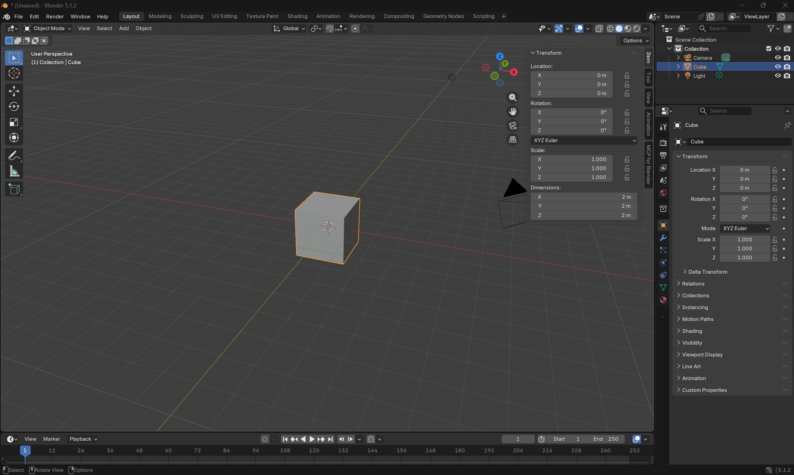

# Blender interface notes

Blender 5.1.2, Windows 11. Written by Rui Sun on 2026-10-15, after a short session of just looking (orbit / pan / zoom), before any Claude prompting in Blender.

Text: Rui's own words. Claude added only the Markdown formatting (headings, image link) and checked the facts against the screenshot; no wording was changed.

*Screenshot: Rui's own Blender 5.1.2 session, 2026-10-15 15:06, default scene, Cube selected.*

## 1. 3D viewport

The 3D Viewport is the large central area of the Blender window. It is where I viewed and navigated around the scene and where objects can be selected, moved, rotated, scaled, and edited.

I navigated with:

* Orbit: drag with the middle mouse button.
* Pan: hold `Shift` and drag with the middle mouse button.
* Zoom: scroll the mouse wheel, or hold `Ctrl` and drag with the middle mouse button.

The label in the top-left said User Perspective, meaning I was viewing the scene from a freely positioned perspective rather than through a fixed front, side, top, or camera view.

## 2. Toolbar

The Toolbar is the vertical strip of icons along the left side of the 3D Viewport. It can be hidden or shown with `T`.

I could see tools for:

* Select Box
* 3D Cursor
* Move
* Rotate
* Scale
* Transform
* Annotate
* Measure
* Add Cube

The active tool in my screenshot was Select Box, shown with a blue background. The Cube was selected and had an orange outline. Orbiting, panning, and zooming were navigation actions, so they did not require changing the active toolbar tool.

## 3. Outliner

The Outliner is in the upper-right corner. It shows the scene as a hierarchy.

My scene contained one collection named Collection, with:

* Camera
* Cube
* Light

Clicking an object's name selects it. The selected row becomes highlighted in the Outliner, and the same object is outlined in orange in the 3D Viewport. In my screenshot, Cube was selected.

The eye and camera-style controls on the right of the Outliner can be used to control whether objects are visible in the viewport and render.

## 4. Properties editor

The Properties Editor is below the Outliner on the right side.

The open tab in my screenshot was Object Properties, identified by the orange square icon. It was showing settings for the selected object, Cube.

The expanded Transform panel showed:

* Location: X = 0 m, Y = 0 m, Z = 0 m
* Rotation: X = 0°, Y = 0°, Z = 0°
* Rotation mode: XYZ Euler
* Scale: X = 1.000, Y = 1.000, Z = 1.000

Other visible sections included Relations, Collections, Instancing, Motion Paths, Shading, Visibility, Viewport Display, Line Art, Animation, and Custom Properties.

## 5. Sidebar (N)

With the mouse pointer inside the 3D Viewport, I can press `N` to open or close the Sidebar. Its Item tab provides another convenient view of the selected object's transform values.

* Location is the object's position along the X, Y, and Z axes.
* Rotation is its orientation around those axes.
* Scale is a multiplier applied to the object's original size.
* Dimensions are the object's actual overall width, depth, and height in the scene.

The default Cube is centered at the origin, has no rotation, and has a scale of `1.000`. Its dimensions are `2 m × 2 m × 2 m`.

This initially seemed surprising: Scale 1.000 does not mean the Cube is 1 metre wide. It means the original mesh is being displayed at 100% of its modeled size. The default mesh itself is already 2 metres wide.

## 6. Mode selector

The Mode selector is at the upper-left of the 3D Viewport. In my screenshot it displayed Object Mode.

With the Cube selected and the pointer over the 3D Viewport, pressing `Tab` switched between:

* Object Mode: I selected and transformed the Cube as one complete object.
* Edit Mode: I could edit the Cube's underlying mesh by selecting its vertices, edges, or faces.

Changing the mesh in Edit Mode changes the shape of the existing Cube; it does not create a separate object. Pressing `Tab` again returned to Object Mode.

## What surprised me / what I want to remember for the brief

* Blender divides one window into several editors, each with a different purpose.
* The Outliner selection and the orange outline in the 3D Viewport refer to the same active object.
* The mouse pointer's location matters because many shortcuts act on the editor under the pointer.
* `T` toggles the Toolbar, while `N` toggles the Viewport Sidebar.
* Orbiting, panning, and zooming change only my view; they do not move the Cube.
* The default Cube is 2 metres wide even though its Scale values are all 1.000.
* Object Mode edits the object as a whole; Edit Mode edits the geometry inside it.
